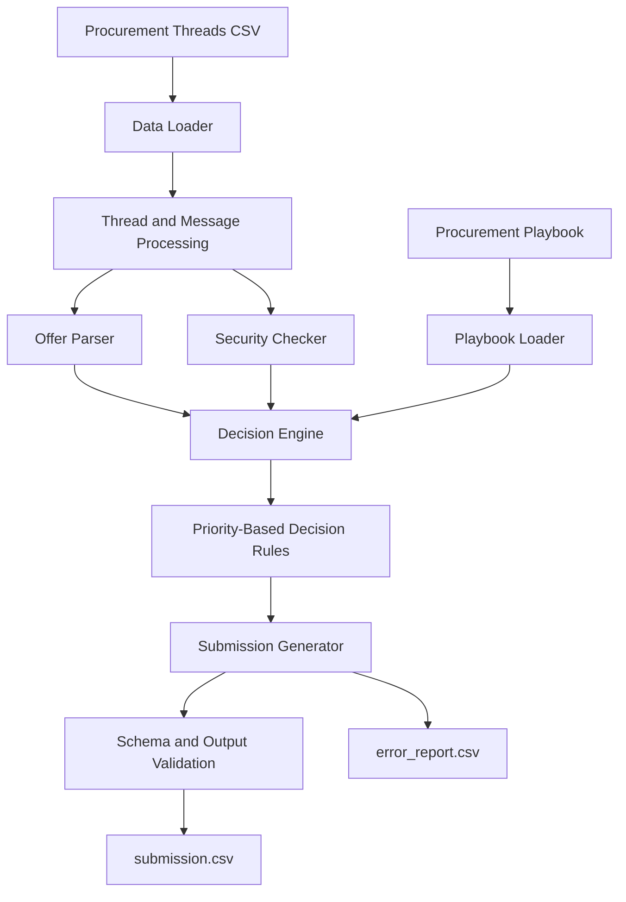

# Vortex — The Procurement Desk

**Data Sprint 2.0 | Agentic AI Track**

An autonomous, deterministic procurement negotiation decision agent developed for the Kaggle competition **Data Sprint 2.0 — The Procurement Desk**.

**Team:** Vortex  
**GitHub:** https://github.com/anirudhsomayaji/procurement-desk  
**Competition:** https://www.kaggle.com/competitions/the-procurement-desk

---

## Table of Contents

1. [Overview](#1-overview)
2. [Mathematical Formulation](#2-mathematical-formulation)
3. [System Architecture](#3-system-architecture)
4. [Implementation Details](#4-implementation-details)
5. [AI Models and External APIs](#5-ai-models-and-external-apis)
6. [Tricky Cases and Handling Strategies](#6-tricky-cases-and-handling-strategies)
7. [Evaluation and Improvements](#7-evaluation-and-improvements)
8. [Real-World Application](#8-real-world-application)
9. [Drawbacks and Limitations](#9-drawbacks-and-limitations)
10. [Original Work and Disclosures](#10-original-work-and-disclosures)
11. [Environment Setup and Reproduction](#11-environment-setup-and-reproduction)
12. [Repository Structure](#12-repository-structure)

---

# 1. Overview

## 1.1 Problem Statement

The Procurement Desk challenge involves automating procurement decisions from supplier negotiation conversations.

Each thread contains information such as:

- Supplier identity and status.
- Procurement category.
- Order quantity.
- Negotiation round.
- Conversation history.
- Previous supplier quotations and counteroffers.
- Applicable procurement policies and contract conditions.

The objective is to evaluate each negotiation thread and produce one valid procurement decision.

## 1.2 Proposed Solution

Vortex is a deterministic, rule-based procurement negotiation agent implemented in Python.

It processes supplier conversation threads, extracts and normalizes quoted prices, checks security and contractual conditions, applies category-specific procurement rules, and generates a structured decision.

The system uses a modular architecture with separate components for parsing, security validation, playbook interpretation, negotiation calculations and submission generation.

It is designed to produce reproducible decisions without relying on external LLM inference services.

## 1.3 Supported Decisions

The agent generates four types of actions:

| Action | Meaning |
|---|---|
| ACCEPT | Supplier offer satisfies the applicable negotiation and approval conditions. |
| COUNTER | Supplier offer exceeds the current acceptable concession level, but another negotiation round is available. |
| REJECT | Supplier is blacklisted or the offer exceeds the walk-away threshold in the final round. |
| ESCALATE | Missing information, security concerns, banned terms or approval-limit violations require review. |

The output label follows this structure:

`ACTION:REASON:COUNTER_PRICE`

Examples:

- `ACCEPT:ACCEPTABLE_PRICE:`
- `COUNTER:COUNTER_OFFER:21000`
- `REJECT:BLACKLISTED_SUPPLIER:`
- `ESCALATE:OVER_APPROVAL_LIMIT:`

A counteroffer contains a whole-number INR amount. Other actions have an empty counter-price field.

## 1.4 Decision Priority

The decision engine follows this strict priority order:

1. **MISSING_INFO:** Missing or unusable supplier pricing, missing subscription billing period, or unsupported currency.
2. **BLACKLISTED:** Supplier is marked as blacklisted.
3. **PROMPT_INJECTION:** Conversation contains detected attempts to manipulate an automated decision system.
4. **BANNED_TERM:** Latest supplier message contains prohibited contractual conditions.
5. **PRICE_DECISION:** Evaluate the normalized price against the concession schedule.
6. **APPROVAL_LIMIT:** Check total order value against the category approval limit.

The first applicable condition determines the decision.

---

# 2. Mathematical Formulation

The agent uses deterministic mathematical calculations to normalize quotations and evaluate supplier offers.

All price comparisons are performed using the normalized price in INR, excluding GST, per category-defined unit.

## 2.1 Currency Conversion

The system supports INR, USD, EUR and GBP.

Default exchange-rate configuration:

| Currency | INR conversion rate |
|---|---:|
| INR | 1.00 |
| USD | 84.50 |
| EUR | 91.00 |
| GBP | 106.00 |

Supplier-specific contract exchange rates take precedence over these defaults.

The conversion is:

\[
P_{\mathrm{INR}}=P_{\mathrm{quoted}}\times R_c
\]

Where:

- \(P_{\mathrm{quoted}}\) = quoted price.
- \(R_c\) = applicable currency-to-INR conversion rate.

Unsupported currencies are treated as missing information and escalated.

These are configured exchange rates, not live market rates.

## 2.2 Price Normalization

The parser extracts the relevant supplier quotation and converts it into a comparable per-unit price.

The following transformations are supported.

**A. Total price for multiple units**

If a supplier quotes a total amount for \(N\) units:

\[
P_{\mathrm{unit}}=\frac{P_{\mathrm{total}}}{N}
\]

**B. Discounted list price**

For a discount percentage \(d\):

\[
P_{\mathrm{discounted}}=P_{\mathrm{list}}(1-d)
\]

**C. Discount on a previous supplier quotation**

\[
P_{\mathrm{new}}=P_{\mathrm{previous}}(1-d)
\]

The previous quotation is extracted from earlier supplier-authored messages, rather than Acme counteroffers.

**D. Free-item offers**

For one free item for every \(k\) paid items:

\[
P_{\mathrm{effective}}=P_{\mathrm{base}}\times\frac{k}{k+1}
\]

**E. Price ranges**

For a quotation containing a price range, the implementation evaluates the higher quoted endpoint.

**F. Tiered pricing**

For quantity-based pricing, the applicable tier is selected using the order quantity and the supplier's stated threshold.

For a further volume discount:

\[
P_{\mathrm{tier}}=
\begin{cases}
P_{\mathrm{base}}(1-d), & Q\geq Q_{\mathrm{threshold}}\\
P_{\mathrm{base}}, & Q<Q_{\mathrm{threshold}}
\end{cases}
\]

**G. Batch and packaging conversion**

The implementation supports:

- Price per pack of four fixtures: divide by 4.
- Price per dozen: divide by 12.
- Price per ream in the printer-paper category: multiply by 10.
- Recognized generic batch quotations: divide by the stated batch quantity.

## 2.3 Subscription Period Normalization

The system converts subscription quotations into the billing period required by the relevant category.

For annual subscription categories:

\[
P_{\mathrm{annual}}=12P_{\mathrm{monthly}}
\]

For monthly subscription categories:

\[
P_{\mathrm{monthly}}=\frac{P_{\mathrm{annual}}}{12}
\]

The implementation applies these conversions to the configured subscription categories.

A missing billing period results in `ESCALATE:MISSING_INFO:`.

## 2.4 GST Normalization

The decision engine compares prices excluding GST.

If a quotation is GST-inclusive:

\[
P_{\mathrm{exclusive}}=
\frac{P_{\mathrm{inclusive}}}{1+g}
\]

Where \(g\) is the GST rate configured for the procurement category.

If the quotation is not identified as GST-inclusive, no GST removal is applied.

## 2.5 Final Normalized Price

The transformations are applied in the implementation's processing sequence:

1. Extract the relevant quoted price.
2. Apply quotation-specific discount or pricing interpretation.
3. Convert packaging and batch quantities.
4. Normalize subscription billing periods.
5. Convert the price into INR.
6. Remove GST when the quotation is GST-inclusive.

The resulting value is:

\[
\boxed{P_{\mathrm{normalized}}=
P_{\mathrm{INR,\ per\ unit,\ excluding\ GST}}}
\]

## 2.6 Concession Schedule

The concession schedule determines the maximum acceptable supplier price at a particular negotiation round.

For a normal supplier:

\[
L(r)=T+(W-T)
\left(\frac{r-1}{R-1}\right)^\beta
\]

Where:

- \(L(r)\) = acceptable concession level at round \(r\).
- \(T\) = target price.
- \(W\) = walk-away price.
- \(R\) = total number of negotiation rounds.
- \(\beta\) = category-specific concession exponent.
- \(r\) = current negotiation round.

Special cases implemented in the code:

- First round: \(L(1)=T\).
- Final round: \(L(R)=W\).
- Probation suppliers: \(L(r)=T\) for every round.

The category-specific values are loaded from the procurement playbook.

A supplier-specific contract price cap, when present, overrides the category walk-away price.

## 2.7 Counteroffer Rounding

When the supplier's normalized price exceeds the acceptable concession level and another negotiation round is available, the agent generates a counteroffer.

The implementation uses:

\[
P_{\mathrm{counter}}=\lfloor L(r)+0.5\rfloor
\]

This rounds to the nearest whole rupee, with half values rounded upward.

## 2.8 Approval Limit

After the supplier's offer satisfies the concession condition, the agent calculates total order value:

\[
V_{\mathrm{order}}=
P_{\mathrm{normalized}}\times Q
\]

Where \(Q\) is the order quantity.

The decision is:

\[
\text{Decision}=
\begin{cases}
\text{ESCALATE}, & V_{\mathrm{order}}>A\\
\text{ACCEPT}, & V_{\mathrm{order}}\leq A
\end{cases}
\]

Where \(A\) is the effective category approval limit.

The approval-limit comparison uses a strict greater-than condition.

---

# 3. System Architecture

## 3.1 Architecture Diagram



## 3.2 Processing Pipeline

**Stage 1 — Input Loading**

The data loader reads the procurement threads and validates the expected input structure.

**Stage 2 — Conversation Processing**

The offer parser identifies the latest supplier message and, where necessary, extracts earlier supplier quotations.

**Stage 3 — Security Checks**

The security checker examines the full conversation for known prompt-injection patterns and checks the latest supplier message for prohibited contractual conditions.

**Stage 4 — Playbook Interpretation**

The playbook loader provides category rules, supplier profiles, contract information and dated amendments.

**Stage 5 — Negotiation Evaluation**

The decision engine applies the six-priority decision procedure and computes the appropriate result.

**Stage 6 — Submission Generation**

The submission generator validates the output and writes the final CSV. It can also generate a separate diagnostic report.

---

# 4. Implementation Details

## 4.1 Technology Stack

| Technology | Purpose |
|---|---|
| Python | Main implementation language |
| Pandas | Tabular data processing |
| NumPy | Numerical support |
| Regular Expressions | Text and quotation pattern extraction |
| Python Dataclasses | Structured decision and offer representations |
| Pytest | Unit and integration testing |
| Markdown | Procurement playbook and policy documentation |

## 4.2 Key Modules

| File | Responsibility |
|---|---|
| `src/agent.py` | Coordinates the complete procurement agent workflow |
| `src/data_loader.py` | Loads and validates input datasets |
| `src/playbook_loader.py` | Reads and structures procurement playbook rules |
| `src/offer_parser.py` | Extracts quotations and normalizes prices |
| `src/security_checker.py` | Detects prompt-injection patterns and banned terms |
| `src/decision_engine.py` | Implements the six-priority decision procedure |
| `src/submission_generator.py` | Generates and validates competition CSV output |
| `run.py` | Provides command-line execution modes |
| `test_agent.py` | Runs sample evaluation |
| `tests/` | Unit and integration tests |

## 4.3 Rule-Based Versus Model-Based Processing

The final implementation uses deterministic Python logic.

- Message and quotation interpretation: regular expressions and predefined parsing rules.
- Security validation: predefined patterns and rule checks.
- Price calculations: mathematical functions.
- Procurement decisions: playbook-driven conditional logic.
- Output generation: Pandas and CSV validation.

No external generative model is used to make the final procurement decisions.

---

# 5. AI Models and External APIs

## 5.1 Model Usage

Vortex uses a deterministic, rule-based agent architecture rather than an externally hosted Large Language Model.

The final decision pipeline does not use:

- Gemini inference APIs.
- OpenAI inference APIs.
- Claude inference APIs.
- External hosted LLM endpoints.
- API-key-based generative AI inference.

The system does not require an API key, paid inference service or GPU to reproduce its decisions.

## 5.2 Prompt Strategy

No LLM prompts are submitted during final prediction generation.

Supplier conversation text is processed using predefined parsing patterns and deterministic security checks.

The prompt-injection detector is a defensive rule-based component that searches for known instruction-manipulation patterns. It does not use a language model to classify messages.

## 5.3 API Calls and Cost

| Item | Final implementation |
|---|---|
| External LLM inference calls | 0 |
| External API calls in decision pipeline | 0 |
| API key required | No |
| External inference cost | None |
| Primary processing | Local Python execution |

This design prioritizes reproducibility, predictable decision logic and independence from external model availability.

---

# 6. Tricky Cases and Handling Strategies

## 6.1 Prompt Injection

The security checker examines the complete conversation for known attempts to influence an automated decision system.

Examples of patterns include:

- Instructions to ignore previous instructions.
- Explicit administrator or system overrides.
- Claims of prior approval.
- Messages directed at an AI agent, language model or automated reviewer.

Certain legitimate business phrases are whitelisted to reduce false positives.

Detection is pattern-based, not semantic LLM classification.

## 6.2 Banned Contract Terms

The latest supplier message is checked for:

- Automatic renewal conditions.
- Upfront or advance payment above 30%.
- Unlimited liability for Acme.
- Supplier exclusivity requirements.

Negated exclusivity wording and permitted renewal language are handled by explicit exceptions in the security checker.

## 6.3 Dated Amendments

Category amendments are applied chronologically when their effective date is on or before the negotiation thread date.

This allows the agent to evaluate a thread using the rules applicable at that time.

## 6.4 Supplier Contracts

Supplier profiles provide information such as:

- Supplier status.
- Contract exchange rates.
- Category-specific price caps.

A supplier contract price cap can replace the category walk-away price for the applicable category.

## 6.5 Trading Names

Supplier identification in the current implementation is based on the supplier names available in the structured playbook.

A general semantic supplier-name or trading-name resolution service is not implemented. Unrecognized supplier identities require correction or review.

## 6.6 Unsupported Currencies

INR, USD, EUR and GBP are supported through configured exchange rates.

Other detected currencies are treated as missing information and escalated rather than converted using an assumed rate.

## 6.7 Corrections

Explicit supplier correction messages are parsed so that the corrected quotation can take precedence over the superseded price.

## 6.8 Multiple Prices

The parser supports several structured quotation formats, including:

- Price ranges.
- Discounted quotations.
- Previous-quote discounts.
- Tiered prices.
- Quantity-based volume discounts.
- Free-item offers.
- Total prices covering multiple units.

The parser uses defined pattern precedence to interpret recognized formats.

## 6.9 Previous Supplier Quotations

When a supplier offers a percentage discount on an earlier quotation, the parser searches earlier supplier-authored messages.

It avoids treating Acme counteroffers as supplier quotations.

## 6.10 Missing Subscription Information

Subscription categories require a recognizable billing period.

If the billing period cannot be established using the supported patterns, the agent escalates the thread for missing information.

---

# 7. Evaluation and Improvements

## 7.1 Evaluation Methodology

The solution was evaluated using:

1. Worked-example evaluation against the provided sample answers.
2. Unit tests for individual parsing and decision functions.
3. Integration tests for the complete agent.
4. Submission validation for the full competition dataset.

## 7.2 Sample Evaluation

The recorded sample evaluation achieved:

| Metric | Recorded result |
|---|---:|
| Sample threads | 40 |
| Exact label matches | 40 |
| Sample accuracy | 100% |

Sample accuracy is calculated as:

\[
\text{Accuracy}=
\frac{\text{Correct predictions}}
{\text{Total sample predictions}}\times100
\]

The sample result measures agreement with the provided worked examples. It does not establish accuracy on unseen evaluation data.

## 7.3 Unit and Integration Testing

The team's previously recorded local validation run reported:

- 52 tests passed.
- Parsing and normalization tests passed.
- Security and decision-priority tests passed.
- Submission-generation tests passed.

The test suite should be rerun from the final committed repository before evaluation. The result reported here must match that final run.

## 7.4 Submission Improvements

The first competition submission achieved a public leaderboard score of 0.99184.

Subsequent improvements focused on edge cases identified through error analysis:

| Area | Improvement |
|---|---|
| Exclusivity detection | Improved recognition of natural-language exclusivity statements |
| Subscription pricing | Added missing billing-period validation |
| Batch quotations | Added normalization for supported batch and packaging formats |
| Previous quotations | Restricted historical quotation extraction to supplier-authored messages |

These changes were designed to improve general parsing behaviour rather than hardcode individual thread IDs or expected output labels.

A subsequent public leaderboard result reached 1.00000. Public leaderboard performance is not equivalent to final private leaderboard performance.

## 7.5 Error Analysis

The development process used targeted tests and diagnostics to investigate:

- Missed contractual restrictions.
- Missing subscription billing periods.
- Incorrect per-unit conversions.
- Confusion between supplier quotations and buyer counteroffers.
- Effective approval limits after applying amendments.

The diagnostic report records information such as action, reason, normalized price, concession level and total order value.

---

# 8. Real-World Application

## 8.1 Potential Applications

A procurement team could use Vortex as an initial decision-support layer for supplier negotiations.

Possible applications include:

- Automated first-level quotation screening.
- Comparing supplier prices on a common unit basis.
- Identifying missing commercial information.
- Flagging prohibited contract conditions.
- Checking supplier eligibility.
- Applying predefined negotiation thresholds.
- Escalating offers that exceed approval limits.

## 8.2 Proposed Deployment Architecture

A real deployment could integrate the agent into an organization's procurement workflow:

1. Supplier conversations enter through an authorized procurement platform.
2. The system validates supplier identity and input structure.
3. The agent processes the conversation and applies approved procurement rules.
4. The system records the decision and supporting diagnostics.
5. Authorized procurement personnel review escalated or high-value decisions.
6. Approved decisions are transferred to the procurement management system.

## 8.3 Safety and Governance Requirements

Before production deployment, the following would be necessary:

- Human approval for consequential procurement decisions.
- Role-based access controls.
- Secure supplier identity verification.
- Audit logs for every decision.
- Version-controlled procurement policies.
- Secure handling of supplier and contract data.
- Regular testing against new quotation formats and security threats.
- Monitoring for incorrect classifications and parsing failures.

Vortex is a competition prototype and should not be treated as a fully certified procurement platform.

---

# 9. Drawbacks and Limitations

The current implementation has several limitations.

### 9.1 Pattern-Based Language Understanding

The parser relies on predefined patterns. Unusual sentence structures, ambiguous quotations and unfamiliar expressions may not be interpreted correctly.

### 9.2 Prompt-Injection Detection

The security checker recognizes known patterns and linguistic indicators. It cannot guarantee detection of every possible prompt-injection attempt.

### 9.3 Supplier Name Resolution

The current supplier lookup relies on structured playbook names. General-purpose trading-name resolution is not implemented.

### 9.4 Currency Coverage

Only configured currencies are supported. Other currencies require an approved exchange-rate policy before they can be processed.

### 9.5 Policy Dependence

The quality of the decisions depends on the completeness and correctness of the procurement playbook, supplier information, category thresholds and amendments.

### 9.6 Human Oversight

The system does not independently establish legal validity, supplier trustworthiness or the commercial suitability of a contract.

Consequential procurement decisions should remain subject to authorized human review.

### 9.7 No LLM-Based Interpretation

The implementation does not use an LLM for contextual reasoning. This makes the decision process reproducible but limits its ability to interpret unfamiliar natural-language expressions beyond the implemented patterns.

---

# 10. Original Work and Disclosures

## 10.1 Team and Project Work

**Team:** Vortex

The project-specific implementation includes:

- Procurement thread-processing workflow.
- Supplier quotation extraction and normalization.
- Security-checking rules.
- Procurement playbook integration.
- Negotiation decision engine.
- Submission generation and validation.
- Unit and integration tests.

Team member names and individual contributions should be listed here according to the actual work performed by each registered team member.

## 10.2 AI-Assisted Development Disclosure

ChatGPT and Google Antigravity were used as development-assistance tools during parts of the implementation and debugging process.

Their assistance included technical explanations, code suggestions, debugging support and documentation assistance.

The final source code, configuration, test results and generated decisions must be reviewed and validated by the team.

No externally hosted generative AI model is called by the final prediction pipeline.

## 10.3 Third-Party Libraries

The project uses the following third-party Python libraries:

- Pandas.
- NumPy.
- Pytest.
- Python-dateutil.

Their dependencies are listed in `requirements.txt`.

The project also uses Python's standard library, including modules for regular expressions, file handling, mathematical calculations and data structures.

## 10.4 External Resources

The procurement policies, category rules, supplier information and amendments are organized in the project's playbook directory.

Any additional external code, templates or resources used by the team should be acknowledged here with their respective sources.

The team should not claim exclusive authorship of third-party libraries or external resources.

---

# 11. Environment Setup and Reproduction

## 11.1 Prerequisites

- Python 3.10 or later.
- Git.
- A local copy of this repository.
- The competition input files in the expected `data/` directory.

The project has previously been tested using Python 3.12.

## 11.2 Clone the Repository

```bash
git clone https://github.com/anirudhsomayaji/procurement-desk.git
cd procurement-desk
```

## 11.3 Create a Virtual Environment

**Windows PowerShell:**

```powershell
python -m venv .venv
.venv\Scripts\Activate.ps1
```

**Linux/macOS:**

```bash
python3 -m venv .venv
source .venv/bin/activate
```

## 11.4 Install Dependencies

```bash
python -m pip install --upgrade pip
python -m pip install -r requirements.txt
```

## 11.5 Run Sample Evaluation

```bash
python run.py --mode sample
```

This evaluates the 40 sample threads against the supplied sample answers and generates:

- `output/sample_predictions.csv`
- `output/sample_evaluation.csv`

## 11.6 Run Tests

```bash
python -m pytest tests -v
```

Alternatively:

```bash
python run.py --mode test
```

## 11.7 Generate the Full Competition Submission

Ensure the competition's `threads.csv` is available at:

`data/threads.csv`

Then run:

```bash
python run.py --mode full
```

The agent processes all 2,000 threads and generates:

- `output/submission.csv`
- `output/error_report.csv`

The submission generator validates the output before writing the final CSV.

## 11.8 Validate the Submission

```bash
python run.py --mode validate
```

The validation checks the submission schema, row count, label formatting, duplicate identifiers and thread ordering.

The expected submission columns are:

```csv
thread_id,label
```

The final file must contain exactly 2,000 data rows.

## 11.9 Kaggle Submission

Upload the generated `output/submission.csv` to the competition's prediction-submission interface.

The separate `output/error_report.csv` is a diagnostic artifact and must never be submitted as the competition prediction file.

For the final evaluation, the `output/submission.csv` committed to this repository must be the same prediction artifact selected for the team's Kaggle submission.

---

# 12. Repository Structure

```text
procurement-desk/
│
├── data/
│   ├── threads.csv
│   ├── sample_threads.csv
│   ├── sample_answers.csv
│   └── sample_submission.csv
│
├── playbook/
│   ├── policies/
│   ├── categories/
│   ├── suppliers/
│   ├── amendments/
│   └── precedents/
│
├── src/
│   ├── __init__.py
│   ├── agent.py
│   ├── data_loader.py
│   ├── playbook_loader.py
│   ├── offer_parser.py
│   ├── security_checker.py
│   ├── decision_engine.py
│   └── submission_generator.py
│
├── tests/
│   ├── test_loading.py
│   ├── test_offer_parser.py
│   ├── test_decisions.py
│   └── test_agent.py
│
├── output/
│   ├── submission.csv
│   ├── error_report.csv
│   ├── sample_predictions.csv
│   └── sample_evaluation.csv
│
├── Procurement_Desk_Solution.ipynb
├── requirements.txt
├── run.py
├── test_agent.py
└── README.md
```

---

**Project:** The Procurement Desk  
**Team:** Vortex  
**Track:** Agentic AI  
**Competition:** Data Sprint 2.0

